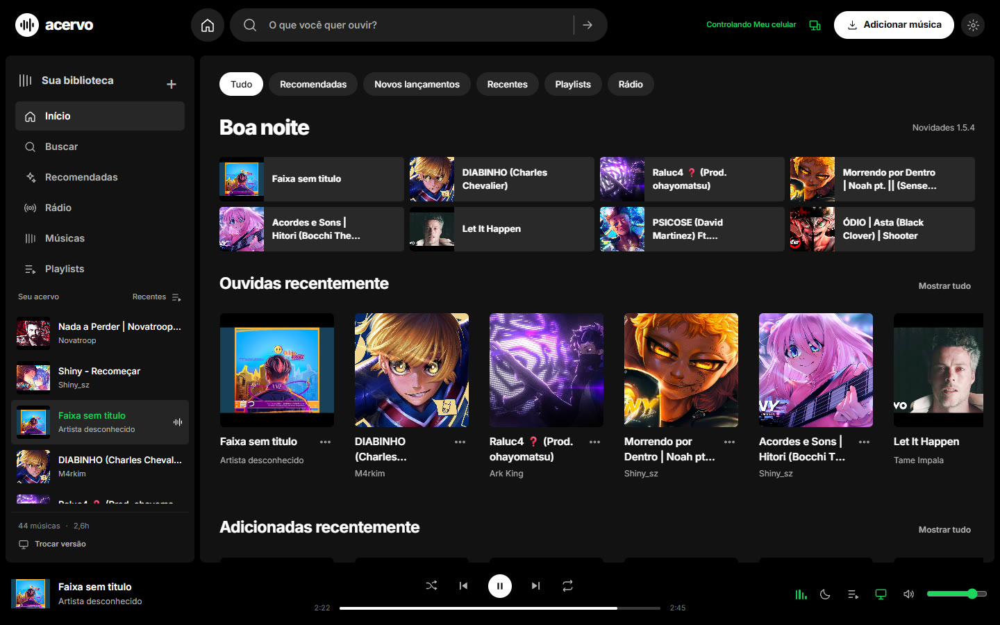
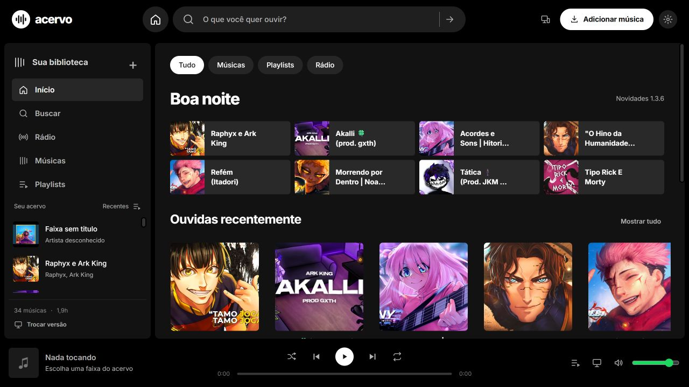
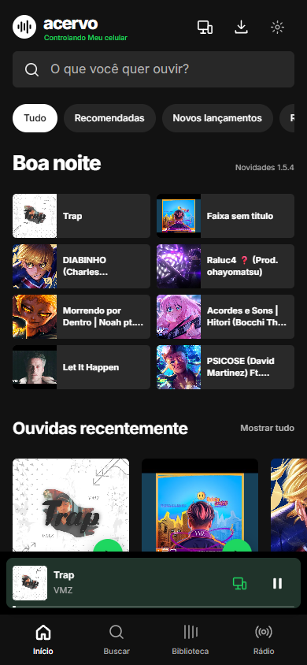
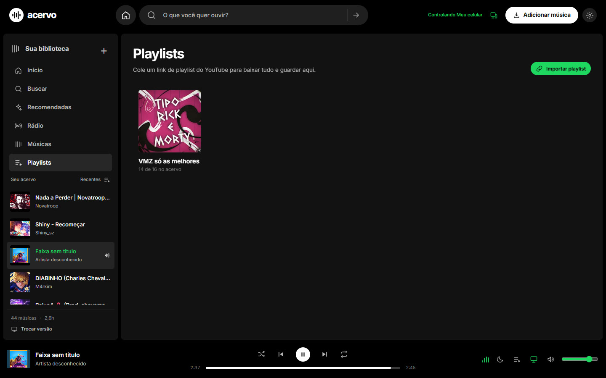
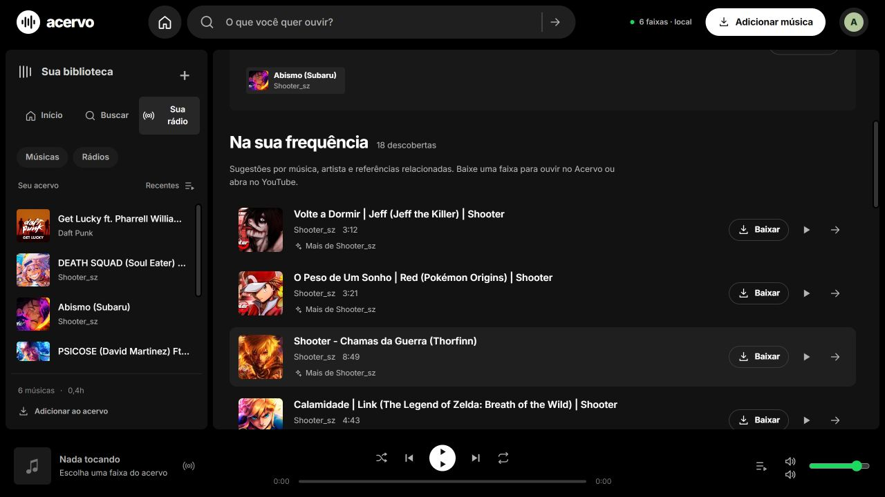

# Acervo

Biblioteca musical local com download de áudio do YouTube, normalização de loudness em **−14 LUFS** e recomendações por similaridade sonora.

Repositório: https://github.com/amarosilvasouza1/acervo

## Capturas











Interface construída a partir do sistema visual descrito em **spotify-design.md**: fundo #000, superfícies #121212/#181818, tinta #fff, apoio #b3b3b3, acento #1ed760, texto sobre acento #111, pills de 1000px, foco visível e suporte a movimento reduzido.

## Rodar

Pré-requisitos:

- Node.js 20+ (testado com v25.9.0)
- Python 3.10 com yt-dlp (python -m pip install -U yt-dlp)
- FFmpeg/ffprobe no PATH
- OpenSSL para criar a identidade criptográfica local; no Windows, pode usar o OpenSSL fornecido pelo Git. Use `OPENSSL_BIN` para informar outro executável.

~~~powershell
git clone https://github.com/amarosilvasouza1/acervo.git
cd acervo
npm install
npm start
~~~

Abra http://127.0.0.1:4310 — ou dê duplo clique em **iniciar.cmd**.

A versão **Web** abre em `/web` e usa a largura real do navegador. No computador, oferece biblioteca lateral e player fixo; no celular, adapta os controles e a navegação. A biblioteca em lista permite filtrar por título/artista e reproduzir somente as faixas visíveis, na ordem escolhida. Início, busca, rádio, playlists e configurações compartilham a mesma interface, sem moldura de telefone ou iframe.

## Versões PC e Web

Na primeira visita, a raiz do Acervo mostra uma tela de escolha. A preferência fica salva no navegador e pode ser trocada a qualquer momento pelo botão de telas no topo do app.

- **/pc** — versão PC: sidebar, fila, player expandido e o fluxo completo de download.
- **/web** — versão Web: usa a largura do navegador, com biblioteca lateral no computador e navegação inferior no celular.
- **/escolher** — tela de escolha; use `?choose=1` para ignorar a preferência salva.

O app Android ignora a escolha e abre direto na biblioteca quando acessa o servidor pelo WebView.

## Descobrir músicas e artistas

Na página inicial, as abas **Recomendadas**, **Novos lançamentos** e **Recentes** abrem a área de descoberta. As recomendações consultam o YouTube a partir das músicas ouvidas; Recentes usa o histórico real de reprodução. Lançamentos mostram apenas datas confirmadas nos últimos 90 dias: primeiro dos artistas do acervo e, quando não houver resultados, da seleção editorial Deezer, identificada na tela.

Clique no nome de um artista nas músicas, na busca ou no player para abrir seu perfil. O perfil reúne músicas salvas, faixas populares, discografia, artistas relacionados e, quando confirmada, uma biografia com atribuição à Wikipédia. Os dados externos vêm do catálogo Deezer; nomes e títulos locais ajudam a confirmar a identidade. Se o perfil não for confirmado, o app preserva as músicas locais e avisa. Contagens de fãs identificam sua fonte; não são ouvintes mensais do Acervo.

Na biblioteca e nos cartões, clicar no nome ou na capa da música inicia a reprodução. O botão de três pontos abre os detalhes; o nome do artista abre seu perfil. Os perfis aceitam capas locais e preservam essa alternativa quando o catálogo não oferece uma foto válida do artista.

Músicas já salvas tocam diretamente. Recomendações do YouTube podem ser adicionadas e reproduzidas; álbuns e faixas apenas do catálogo abrem a busca para você escolher uma versão. O botão **Atualizar** repete a consulta; novas reproduções atualizam Recentes. `npm test` verifica os serviços e a interface, e `npm run test:catalog` verifica as rotas em uma biblioteca temporária.

## MCP para IAs

O Acervo expõe um servidor MCP local para agentes de IA pesquisarem, criarem playlists e controlarem a reprodução da versão Web (play, pause, next, previous, seek). As ferramentas usam a API local e os comandos são executados pela aba Web aberta em `http://127.0.0.1:4310`.

```json
{
  "mcpServers": {
    "acervo": {
      "command": "node",
      "args": ["C:\\caminho\\para\\acervo\\mcp\\acervo-mcp.mjs"],
      "env": { "ACERVO_URL": "http://127.0.0.1:4310" }
    }
  }
}
```

Os endpoints `/api/mcp/*` aceitam somente host local e não são expostos pelo relay público. Veja [mcp/README.md](mcp/README.md) para as ferramentas e limitações.

## Novidades 1.6.0

- O APK usa os mesmos arquivos da web mobile também no modo independente e offline. Biblioteca, busca, artistas, fila e player compartilham a interface; os arquivos da tela ficam no APK e abrem sem o PC.
- Conectado ao PC, o app dá preferência à música já salva na biblioteca do celular pelo mesmo identificador. O áudio e os trechos solicitados para avançar na música são lidos do arquivo privado, sem nova transferência do servidor. Faixas ausentes continuam vindo do PC.
- O modo do celular preserva a biblioteca existente e continua buscando e baixando pela própria internet. O menu de três pontos reúne conexões, sincronização, atualização e licenças.

## Histórico 1.5.9

- Fila em painel próprio sobre o player, com música atual, próximas e histórico da sessão. As opções de mover e remover ficam no menu de cada faixa; editar a fila também funciona no dispositivo de reprodução conectado.
- Player limitado à altura disponível, com cabeçalho fixo e rolagem interna. O fundo desfocado fica recortado dentro do painel.

- Capas com faixas pretas uniformes em cima e embaixo recebem um recorte automático de exibição. A detecção exige bordas equilibradas e um limite visível com a imagem; capas escuras e casos incertos são preservados.
- As capas já salvas no PC são verificadas sem alterar os originais. As versões de exibição ficam em `data/cover-display`, com cache por conteúdo.
- No Android, o mesmo ajuste funciona nas capas salvas e novas, inclusive offline, no player e na notificação.

## Histórico 1.5.8

- O PC recebe áudio e metadados na mesma extração do YouTube. A playlist preenche duas vagas de importação e pedidos repetidos da mesma faixa compartilham o trabalho.
- No Android, arquivos a partir de 2 MB usam até dois leitores de partes de 1 MB quando a fonte aceita Range. Cada resposta, tamanho e identidade informada é conferida antes de guardar o áudio. Fontes sem suporte usam o download normal.
- A página do artista destaca foto, músicas populares, discografia, informações confirmadas e sua coleção. O player expandido reúne capa, perfil e próximas músicas.
- O modo independente do Android consulta e guarda metadados do catálogo quando encontra um perfil compatível. A biblioteca e os perfis já consultados continuam acessíveis offline.

## Histórico 1.5.7

- **Download mais rápido:** até duas músicas em paralelo, mantendo o processamento e a qualidade de áudio configurados, com fragmentos do YouTube baixados em paralelo pelo yt-dlp.
- **Tela do artista mais completa:** capa de fundo, foto, contagem de músicas, botão Tocar tudo quando o artista está no acervo e atalhos para buscar e abrir a fonte.
- **Player refinado:** fundo com a capa desfocada, capa maior, contexto do álbum, atalhos de Fila e Artista e controles mais legíveis. A estrutura continua a mesma, sem letras nem visualizador.

## Histórico 1.5.6

- **Link de música do Spotify:** cole uma faixa em `open.spotify.com/track/…` ou `spotify:track:…` e o Acervo busca título, artista e duração, procura a versão no YouTube e baixa como uma música única.
- O fluxo de prévia e importação é o mesmo das playlists, com relatório de sucesso ou falha por faixa.

## Histórico 1.5.5

- **Notificação com linha do tempo real:** o player em segundo plano informa posição e duração continuamente, aceita seek e mostra play/pause, anterior e próxima.
- O toque na notificação abre a tela que está tocando: o player nativo quando o áudio é local, ou o WebView conectado quando a música vem do Acervo do PC.
- **Importação de playlists:** link público do Spotify, playlist do YouTube ou arquivo CSV/JSON, com prévia, busca correspondente no YouTube e relatório de músicas baixadas ou com falha.

## Histórico 1.5.4

- O APK reaproveita conexões HTTPS e o contexto TLS do PC pareado, evitando repetir a negociação a cada capa e consulta. A identidade dos dois aparelhos continua sendo verificada.
- O encaminhador Bore atende até 32 conexões simultâneas e mantém uma fila limitada a 32 pedidos por até quatro segundos para absorver a abertura da página. A latência do serviço público ainda pode afetar o acesso.

## Histórico 1.5.3

- O Android abre direto no Início e lembra se você estava usando o PC ou a biblioteca do celular. O leitor de QR fica em **Conexões**; voltar do Início não abre o pareamento.
- A conexão ao PC só é lembrada depois da autenticação confirmada. O convite do QR continua temporário e não é salvo.
- O modo do celular usa os mesmos padrões de navegação, cores, cartões, listas e player do modo conectado. As recomendações offline usam o histórico e as músicas salvas; pesquisas e novos downloads continuam dependendo de internet.
- Ao salvar ou sincronizar músicas do PC, o celular guarda também a capa disponível para mostrar a mesma arte offline.

## Histórico 1.5.2

- Corrigida a autorização da chave do Android usada pelo TLS. Instale o APK 1.5.2 por cima da versão anterior e escaneie um QR novo para atualizar a identidade criada pelo 1.5.0.
- Apenas uma instância pode usar a mesma pasta de dados. Isso impede gerar um convite em um servidor enquanto o endereço público encaminha para outro.
- Convites continuam disponíveis em memória para tentar novamente após uma falha temporária; uma resposta de pareamento perdida é recuperada antes de reenviar o convite.
- Erros de conexão no APK distinguem DNS, rede, tempo de resposta e autenticação, sem mostrar tokens ou detalhes privados.
- O encaminhador mantém conexões ociosas e usa TCP keepalive; o prazo de abertura continua limitado.

## Histórico 1.5.1 no PC

- QR com 256 bits de aleatoriedade, expiração de cinco minutos e uso único. Solicitar outro invalida o anterior imediatamente, inclusive com gerações concorrentes.
- **Dispositivos → Conectar pela internet** ativa um encaminhamento TCP que preserva a autenticação mútua. Use o APK 1.5.2 ou posterior, sem instalar Tailscale.
- Verificação explícita do DNS público, identidade do PC e recusa de acesso sem a chave do celular. Um encaminhamento configurado ainda não é anunciado como verificado enquanto esse teste não passar.
- Os atalhos `iniciar-internet.cmd` e `parar-internet.cmd` usam os controles do Acervo e preservam outros serviços já configurados no PC.

Veja [conexão por outra rede](docs/internet.md). A biblioteca continua no PC; o acesso externo depende de ele estar ligado e de o serviço de encaminhamento estar disponível.

## Histórico 1.5.0

- Corrigido o envio parcial de áudio que podia interromper o APK conectado perto de 44 segundos. Pedidos `Range: bytes=0-` agora recebem a faixa até o fim.
- Downloads e sincronização preservam título e artista da seleção. A consulta oficial oEmbed do YouTube oferece uma alternativa quando a extração de metadados falha.
- No modo PC local, autenticação mútua por certificado: somente um celular fica vinculado. Uma sessão copiada não substitui sua chave privada.
- O QR leva a identidade pública do PC e um convite temporário de uso único. As chaves privadas ficam em cada aparelho; a do telefone usa o Android Keystore.
- O vínculo sobrevive ao reinício do servidor. Remover o celular pelo PC revoga o acesso; outro aparelho precisa de um novo QR.
- O painel administrativo HTTP fica no próprio PC por padrão. Rotas de arquivos recusam caminhos externos, links e junções.
- Para hospedar no próprio PC fora de casa, `ACERVO_PUBLIC_ENDPOINT` aceita seu endereço HTTPS público. Ele exige uma rota de rede até a porta HTTPS do PC e não contorna CGNAT.

O processo Node normal no Windows mantém as permissões da sua conta. Para isolamento de arquivos e processos, existe um perfil opcional de contêiner Linux; veja [docs/isolation.md](docs/isolation.md). Nenhum contêiner ou acesso público foi ativado automaticamente.

Para corrigir faixas antigas salvas como **Faixa sem título** ou **Artista desconhecido**, pare o servidor e execute `npm run repair:metadata`, depois inicie-o novamente. O reparo consulta somente o ID original do YouTube, preenche rótulos ausentes e cria um backup em `data/`; áudio, nomes já confirmados e histórico são preservados. Faixas indisponíveis continuam com seus dados anteriores.

## Histórico 1.4.0

- APK com navegação inferior, início com recentes/artistas, biblioteca em linhas, mini player e player expandido nos modos independente e offline.
- Capas carregadas ficam no cache privado do celular para uso offline.
- QR local com identidade do computador: HTTPS para biblioteca, controles, rádio, sincronização e áudio, com recusa de uma chave diferente da pareada.
- Compare o código em **Proteção** no APK com o código no PC. Atualize os dois lados e escaneie um novo QR para substituir conexões locais antigas por HTTP.

A comunicação usa TLS autenticado pelo QR, sem implementar o protocolo de mensagens do WhatsApp. Veja [como a proteção funciona](docs/security.md).

## Histórico 1.3.6

- **Conexão salva no celular:** o APK abre direto no último Acervo conectado; o botão **Conexão** permite trocar de servidor.
- **Segundo plano e tela desligada:** a música continua ao minimizar ou apagar a tela, com play/pause, anterior e próxima na notificação.
- **Notificação no modo conectado:** os controles também aparecem quando o som vem do Acervo no PC.
- **Músicas no celular:** salve uma faixa ou a biblioteca inteira em MP3 e ouça em **Ouvir offline**, sem depender do PC.
- **Sincronizar mais rápido:** o botão Sincronizar copia os MP3 que já estão no PC direto para o celular, sem rebaixar do YouTube.
- **Notificação repaginada:** capa da faixa e ícones de play/pause no estilo Spotify.
- **Configurações:** baixar ao tocar, abrir as músicas salvas se a conexão cair e continuar de onde parou.
- **Playlists do YouTube:** cole um link, a playlist é criada no app/web e todas as faixas entram na fila de download.
- **Tela desligada:** o serviço mantém CPU e Wi-Fi ativos durante a reprodução.
- **Aleatório inteligente:** a fila embaralhada intercala artistas e evita repetir o mesmo nome em sequência.
- **Rádio com prefetch:** no modo independente, a próxima sugestão é baixada enquanto a atual toca.
- **Continuar de onde parou:** o PC e a versão Web lembram a última faixa e a posição.
- **Timer de sono:** pausa automática em 15, 30, 60 ou 90 minutos.
- **Buscas recentes:** as últimas buscas ficam salvas para repetir com um toque.

A tela **Novidades** dentro do app resume essas mudanças e pode ser dispensada.

## Acessar o PC fora de casa (Tailscale)

O Acervo pode continuar no seu PC e ser acessado de qualquer rede pelo celular, sem abrir portas no roteador, usando a tailnet privada do Tailscale.

1. Mantenha o Tailscale instalado e conectado no PC e no celular, com a mesma conta.
2. No PC, rode **iniciar-externo.cmd**. Ele publica o Acervo em HTTPS na porta 10000 da tailnet e inicia o servidor em modo nuvem.
3. Abra o endereço mostrado. O Acervo reconhece sua identidade do Tailscale e entra direto, sem senha; se quiser parear o APK, gere o QR em **Conectar dispositivos**.
4. No celular, com o Tailscale ligado, abra o endereço no APK (ou escaneie o QR). Funciona fora de casa enquanto o PC estiver ligado e o servidor aberto.
5. Para encerrar o acesso externo, feche a janela do servidor e rode **parar-externo.cmd**.

O endereço fica disponível apenas dentro da sua tailnet — não é publicado na internet. O APK 1.5.5 já aceita links HTTPS; no modo local, PC e celular usam TLS autenticado pelo QR e identidade própria do telefone. O modo local (**iniciar.cmd**) continua sendo o mais simples para usar em casa. O acesso pela tailnet é autenticado pela identidade do Tailscale, não por senha. A senha em **externo.env** é apenas um fallback técnico para acesso sem a identidade da tailnet e não é solicitada no uso normal; mantenha esse arquivo privado.

## Android independente e conexão entre dispositivos

Instale [releases/acervo-1.6.0.apk](releases/acervo-1.6.0.apk) no Android 8 ou superior. Pode instalar por cima da versão anterior: a assinatura foi mantida. O botão **Baixar APK Android** em **Conectar dispositivos** também entrega esse arquivo. O APK abre no último modo usado; use **Conexões** no menu de três pontos para parear outro Acervo.

Na tela inicial do APK, toque em **Usar neste celular**. O Android pesquisa no YouTube, resolve o áudio, baixa e reproduz pela própria conexão à internet. Funciona em outra rede e com o computador desligado. As músicas ficam na área privada do aplicativo e tocam sem internet depois de baixadas. A rádio usa uma música escolhida ou a última ouvida para buscar sugestões atuais; nenhuma hospedagem é necessária para esse modo.

O Android guarda M4A ou WebM de áudio, conforme a fonte. A conversão para MP3, a normalização em −14 LUFS e a análise de timbre continuam no servidor do PC. O player continua em segundo plano, com play/pause e próxima na notificação; no modo rádio, a próxima faixa é baixada enquanto a atual toca. Desinstalar apaga a biblioteca local; atualizar com a mesma assinatura mantém os dados.

Para levar o acervo do PC, abra uma faixa e toque em **Salvar no celular**, ou use **Salvar biblioteca no celular** no menu. Os MP3 ficam na área privada do app e aparecem em **Ouvir offline**; continuam tocando sem PC, sem servidor e sem internet. Salvar a biblioteca inteira consome espaço e tempo de download; as faixas já salvas são puladas.

Para conectar as duas versões:

1. No computador, abra **http://127.0.0.1:4310** e gere um QR em **Conectar dispositivos**.
2. No APK, use **Escanear QR code**. Links locais precisam do computador ligado e acessível pela rede; um servidor HTTPS configurado permite conexão pela internet.
3. O modo conectado compartilha biblioteca, fila e controles em tempo real. **Ouvir aqui** transfere a reprodução entre as telas conectadas.
4. Na barra nativa do modo conectado, toque em **Sincronizar** para comparar os catálogos. Músicas faltantes são baixadas no celular e pedidos de download são enviados ao PC. Nada é apagado; cada versão mantém sua cópia e seu histórico. Os pedidos no PC continuam sujeitos ao progresso da fila de importação.

O celular continua independente depois da sincronização. Controlar um computador desligado e trocar dados com ele enquanto está inacessível exige aguardar sua volta. Uma biblioteca central hospedada é uma opção adicional, documentada em [docs/cloud.md](docs/cloud.md); nenhum servidor foi contratado ou publicado.

Cada QR vale cinco minutos e é usado uma única vez. No modo local, use o leitor do APK para confirmar a identidade do PC e apresentar a identidade do telefone. Apenas um celular fica autorizado; remova-o no PC antes de vincular outro. A porta HTTPS é a HTTP + 1 (4311 por padrão), ajustável por `ACERVO_HTTPS_PORT`. Guarde `data/identity` e `data/paired-phone.json` no backup privado do servidor. O vínculo permanece após reiniciar; apagar ou reinstalar o APK perde a chave privada do telefone e exige revogar o vínculo antigo no PC.

O botão **Atualizar aplicativo** consulta novas versões no servidor lembrado. O canal de atualizações pelo GitHub ainda não está configurado; o repositório será informado depois. Sem servidor lembrado, o aplicativo explica que o canal precisa ser configurado. A atualização valida o pacote e a mesma assinatura antes de abrir o instalador do Android. A primeira instalação ainda usa o APK entregue aqui. Veja [android/README.md](android/README.md) para compilação, assinatura e publicação.

No modo local, o painel HTTP escuta apenas em `127.0.0.1`; o celular usa a porta HTTPS e sua chave privada. Se o Windows solicitar acesso de rede para o Node.js, permita a rede em que pretende usar o app. O aplicativo não abre portas no roteador nem altera o firewall. Um endereço em `ACERVO_PUBLIC_ENDPOINT`, como `https://acervo.seu-dominio.com`, habilita QR e validação desse endereço, mas requer DNS e encaminhamento TCP até o PC; a conexão TLS deve terminar no Acervo. Veja [docs/isolation.md](docs/isolation.md).

Para voltar a restringir o servidor ao próprio computador:

~~~powershell
$env:ACERVO_HOST = "127.0.0.1"
npm start
~~~

Se uma versão antiga estiver rodando, feche o servidor anterior e inicie novamente para carregar as funções de conexão.

## Usar

1. **Buscar**: pesquise por faixa/artista ou cole um link do YouTube no topo.
2. **Baixar**: baixa o melhor áudio disponível, converte para MP3 44,1 kHz, mede o loudness e normaliza em −14 LUFS (true peak −1 dB).
3. **Acervo**: capa, artista, BPM, LUFS, duração, ordenação e filtro local.
4. **Parecidas**: no painel da faixa, a similaridade cruza andamento, energia, brilho espectral e ruído, com bônus para mesmo artista/gênero.
5. **Rádio ao vivo**: descubra novas músicas a partir das ouvidas recentemente, de uma faixa do acervo ou de um nome de música/artista. Os resultados aparecem conforme as buscas no YouTube terminam. Ao digitar, a busca é atualizada automaticamente; mudar a referência ou sair da rádio cancela a pesquisa anterior.
6. **Descobrir**: usa artistas relacionados (Deezer) e busca no YouTube para sugerir novas faixas.

A rádio usa música de referência, artista, colaboradores identificados e artistas relacionados para buscar novidades online. Exclui faixas já salvas, a própria referência e resultados repetidos. A análise de BPM e timbre continua disponível nas recomendações **Parecidas no acervo**; os resultados online ainda não tiveram seu áudio analisado.

Use **Baixar** para guardar uma descoberta, o botão de play ao lado para **baixar e ouvir**, ou a seta para abrir no YouTube. O histórico é salvo localmente após a reprodução começar. A rádio de escutas recentes acompanha novas reproduções e renova a busca a cada 90 segundos enquanto a tela está aberta; **Parar busca** suspende essa atualização até você atualizar ou escolher outra referência.

## Como funciona

~~~text
yt-dlp            -> melhor áudio do vídeo
ffmpeg loudnorm   -> 1ª passada mede, 2ª normaliza em -14 LUFS (TP -1)
libmp3lame        -> MP3 VBR ~190 kbps, 44,1 kHz, estéreo
análise local     -> RMS/energia, ZCR, centroide espectral por FFT,
                     BPM por autocorrelação do fluxo de onsets
similaridade      -> distância ponderada + artista/gênero
~~~

Se o YouTube pedir verificação anti-bot, o download tenta automaticamente os clientes **android**, **web_embedded** e **android_vr** antes de desistir. Para vídeos que exigem login, exporte cookies do seu navegador e inicie com:

~~~powershell
$env:ACERVO_COOKIES_BROWSER = "chrome"   # ou edge, firefox, brave
npm start
~~~

## Estrutura

~~~text
server.js          servidor HTTP, rotas e fila de importação
lib/connect.js     pareamento, sessões, presença e player compartilhado
lib/yt.js          busca, metadados e download com fallback de clientes
lib/audio.js       loudness, normalização e extração de features
lib/library.js     persistência em data/library.json
lib/radio.js       rádio online com resultados progressivos e cancelamento
public/            interface (HTML/CSS/JS sem framework)
public/connect.js  controles remotos, dispositivos, QR e reprodutor expandido
public/mobile.css  interface de celular com áreas seguras e abas inferiores
data/tracks/       MP3 normalizados
data/covers/       capas
data/trash/        faixas removidas (recuperáveis)
tests/             testes de backend e de interface (Node test runner)
~~~

## API

- GET /api/health — estado e número de faixas
- GET /healthz — verificação pública mínima para a hospedagem
- GET /api/app/version — versão Android e checksum do APK disponível
- GET /api/search?q= — busca no YouTube (cache de 5 min)
- POST /api/import — { videoId | url | query }; retorna jobId
- GET /api/jobs/:id — progresso/etapa/erro
- GET /api/library — faixas + estatísticas
- GET /api/stream/:id — áudio com Range
- GET /api/cover/:id — capa
- GET /api/recommend/:id — parecidas com score e motivos
- GET /api/discover/:id — sugestões externas
- POST /api/radio — { seedId? | query?, excludeIds?, limit? }; resultados ao vivo via SSE. Sem referência explícita, usa o histórico recente.
- POST /api/track/:id/play — registra reprodução no histórico local
- DELETE /api/track/:id — move para data/trash
- GET /api/connect/info — dispositivos e estado compartilhado (exige pareamento remoto)
- POST /api/connect/register — registra o player local do computador
- POST /api/connect/pairing — gera QR code no computador
- POST /api/connect/claim — troca o código de pareamento por uma sessão do aparelho
- GET /api/connect/config — informa se o servidor está no modo nuvem
- POST /api/connect/login — entrada por senha no modo nuvem
- POST /api/connect/logout — encerra a sessão no modo nuvem
- GET /api/connect/events — eventos de dispositivos, comandos, player e biblioteca por SSE
- POST /api/connect/state — estado do player enviado pela saída de áudio ativa
- POST /api/connect/command — controle remoto e transferência entre aparelhos
- DELETE /api/connect/devices/:id — revoga uma conexão a partir do computador

## Verificar

~~~powershell
npm test
~~~

Os testes cobrem resultados progressivos, histórico, referências, repetições, cancelamento, falhas de fontes, controles da rádio, pareamento, expiração, revogação, transferência e sincronização entre dois clientes. Não precisam baixar músicas nem alterar o acervo existente.

`npm run test:connect` e `npm run test:tls` verificam HTTPS, identidade, QR, eventos, áudio parcial, troca de reprodução e revogação usando portas e bibliotecas temporárias, sem abrir a biblioteca do usuário. Conferem também a recusa de HTTP na rede e de uma identidade alterada.

## Limites e uso

O download depende do YouTube e pode falhar por verificação anti-bot, região ou disponibilidade do vídeo — a interface mostra o motivo. Baixe apenas conteúdo que você tem direito de usar. O Acervo não contorna DRM, paywall ou controle de acesso; cookies são opcionais e ficam na sua máquina.
